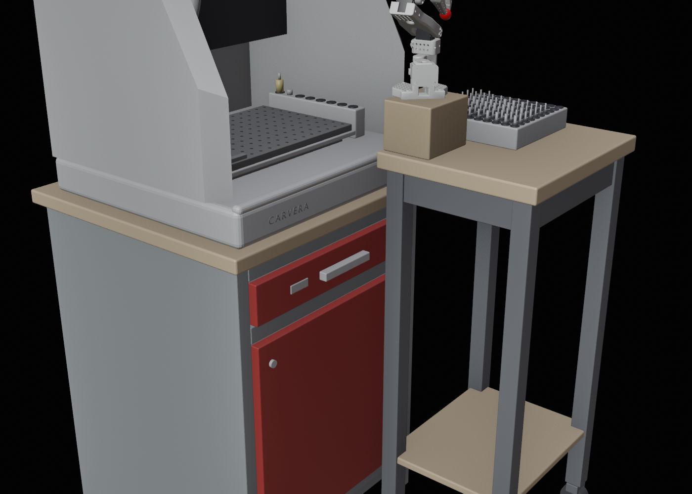

# Carvera Robot Arm

A robot arm that changes the tools in a **Makera Carvera** desktop CNC's
automatic tool changer (ATC): it takes Makera bits from a rack beside the
machine, puts them in the six ATC slots and brings them back.

The arm is a **SO-ARM101** (TheRobotStudio / Seeed Studio), a 5-axis hobby
arm. The cell is modelled as a digital twin and runs in simulation on
[Intrinsic Core](https://github.com/intrinsic-ai/intrinsic-core). The CNC
sits on a Küpper workshop bench, and the arm and the bit rack stand beside it
on a rolling cart.

<p align="center">
  
</p>

> **Status: simulation only, work in progress.**
>
> - With the gripper kept vertical, the SO-101 reaches about 12–28 cm from its
>   base. From the cart, that covers ATC slots **T3–T6**, but not T1–T2 and not
>   the far cells of the 10 × 10 bit rack. A new arm mount (tilted, closer or on
>   a short rail) is being worked out, so the arm can reach all six slots.
> - Bits move in the world model (and in RViz). In Gazebo the SO-101 jaw is
>   only positioned, never closed on the shank, so nothing is physically gripped.
> - There is no hardware driver for the SO-101 yet.

## What's in it

| Part | Where | Notes |
| :--- | :--- | :--- |
| Makera Carvera | [`models/makera_carvera/`](models/makera_carvera/) | Shape from Makera's manual views and photos, hinged hood, bed, parked gantry, ATC rack with frames `atc_slot_0` (probe) … `atc_slot_6`. Generated in Blender by `build_carvera.py`. |
| Makera bit catalogue | [`models/makera_bits/`](models/makera_bits/) | 81 bits (end mills, ball nose, O-flute, corn, engraving, drills, thread mills, UV solder-mask tool …), each a scene object with a `grip_frame` on the shank. Dimensions from Makera's product listings; collars and some lengths are estimates. Generated by `build_bits.py`. |
| SO-ARM101 arm and gripper | [`models/so101/`](models/so101/), [`models/so101_gripper/`](models/so101_gripper/) | TheRobotStudio's official meshes and URDF kinematics (Apache-2.0), as a sim hardware module. |
| Bench, cart, pedestal, bit rack | [`models/carvera_bench/`](models/carvera_bench/), [`models/robot_cart/`](models/robot_cart/), [`models/so101_stand/`](models/so101_stand/), [`models/bit_grid_21/`](models/bit_grid_21/) | Küpper bench (one drawer above one door), cart top level with the ATC seats, 10 × 10 rack at 21 mm pitch. |
| Cell layout | [`configs/carvera_so101/`](configs/carvera_so101/) | World updates for the cell and the bits, application config. Generated by `gen_cell_configs.py`. |
| `move_bit` | [`tools/atc/`](tools/atc/) | Moves bits between the rack and the ATC: `--move`, `--fill_atc`, `--empty_atc`. Has its own SO-101 IK (`so101_ik.py`) that keeps the gripper vertical. |

The repo also still has the original OMTS cell (UR5e with a Robotiq Hand-E)
with the Carvera in it, as `--//:setup=omts`. `move_bit` works there too.

## Running it

You need an Intrinsic Core installation with a simulated solution; see the
[Getting Started guide](https://github.com/intrinsic-ai/intrinsic-core/tree/main/developer_resources/learn/tutorials/getting_started.md).
Then, from the repo root:

```bash
# Deploy the SO-101 cell in simulation
bazel run -c opt --//:setup=carvera_so101 //:omts_solution -- \
  --address=localhost:17080 --operation_mode=sim

# Lay out the cell and the bits, and restart Gazebo on the new world
inctl world reset --address=localhost:17080
bazel run -c opt //tools/world:apply_scene_updates -- --address=localhost:17080 \
  --files $PWD/configs/carvera_so101/cell.updates.pbtxt \
          $PWD/configs/omts/schunk.updates.pbtxt \
          $PWD/configs/carvera_so101/bits.updates.pbtxt --reset_sim

# Move bits
CFG=--config=configs/carvera_so101/app_config.yaml
bazel run -c opt //tools/atc:move_bit -- $CFG --list
bazel run -c opt //tools/atc:move_bit -- $CFG --move=grid:4,4:atc:4
bazel run -c opt //tools/atc:move_bit -- $CFG --fill_atc
bazel run -c opt //tools/atc:move_bit -- $CFG --empty_atc
```

Watch it in RViz with `configs/omts/omts.rviz`. See
[`tools/atc/README.md`](tools/atc/README.md) for how `move_bit` plans its
moves.

## Regenerating the models

The models and layouts are generated from scripts, so edit those rather than
the `.sdf`, `.glb` or `.pbtxt` files:

```bash
# Carvera, ATC tool holder and bit racks (Blender 4.x)
blender -b --python models/makera_carvera/build_carvera.py -- models
# Bit catalogue: .glb, .sdf and manifests, bits.bzl, makera_bits.json
blender -b --python models/makera_bits/build_bits.py -- models/makera_bits
# SO-101, gripper, pedestal, bench and cart (needs TheRobotStudio's meshes)
models/so101/fetch_meshes.sh
blender -b --python models/so101/build_so101.py -- models
# Cell and bit layouts
python3 configs/carvera_so101/gen_cell_configs.py
```

## Repository layout

| Path | Contents |
| :--- | :--- |
| `models/` | Scene objects and the SO-101 hardware module. See [`models/README.md`](models/README.md). |
| `configs/` | One directory per cell: `carvera_so101`, `omts` (UR5e), `lab_bb_01`. See [`configs/README.md`](configs/README.md). |
| `tools/atc/` | `move_bit` and the SO-101 IK. |
| `tools/`, `src/`, `tests/` | The OMTS application, skills, diagnostic tools and tests this project builds on. |
| `docs/` | [OMTS documentation](docs/OMTS.md), [architecture](docs/ARCHITECTURE.md), [workshop guide](docs/WORKSHOP.md). |

## Origins and licences

This project is a fork of the **Open Machine Tending Solution (OMTS)**, an
Apache-2.0 reference application by Intrinsic
([intrinsic-ai/intrinsic-omts](https://github.com/intrinsic-ai/intrinsic-omts)).
The Carvera, the bit catalogue, the SO-101 cell and `move_bit` were added here;
the rest is OMTS, documented in [`docs/OMTS.md`](docs/OMTS.md). It is not an
Intrinsic product, and it is not affiliated with or endorsed by Intrinsic,
Makera, TheRobotStudio or Seeed Studio.

- Code and models: Apache License 2.0, see [`LICENSE`](LICENSE) and
  [`AUTHORS.txt`](AUTHORS.txt).
- SO-101 meshes and kinematics: TheRobotStudio SO-ARM100, Apache License 2.0,
  see [`models/so101/LICENSE.SO-ARM100`](models/so101/LICENSE.SO-ARM100).
- Makera, Carvera, Intrinsic, Küpper and SO-ARM101 are trademarks of their
  owners and are used here only to name the products modelled. See
  [`TRADEMARK.md`](TRADEMARK.md) for Intrinsic's marks.
- NVIDIA FoundationPose (used by the OMTS pose estimator) has its own licence
  terms, see [`docs/OMTS.md`](docs/OMTS.md#7-licensing-information-for-nvidia-foundationpose).
