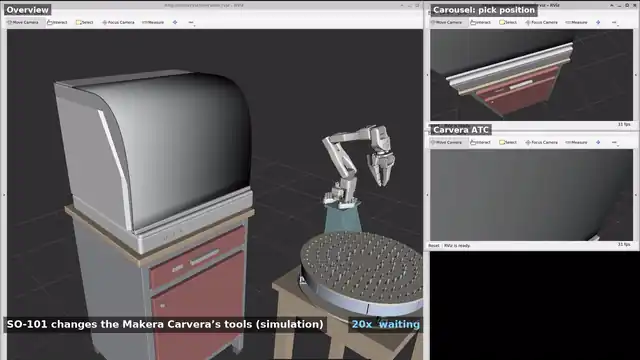

# Carvera Robot Arm

A robot arm that changes the tools in a **Makera Carvera** desktop CNC's
automatic tool changer (ATC): it takes Makera bits from a turning bit
carousel beside the machine, puts them in the six ATC slots and brings them
back.

The arm is a **SO-ARM101** (TheRobotStudio / Seeed Studio), a 5-axis hobby
arm. The cell is modelled as a digital twin and runs in simulation on
[Intrinsic Core](https://github.com/intrinsic-ai/intrinsic-core). The CNC
sits on a Küpper workshop bench; the arm and the carousel stand in front of
it on a rolling cart, which rolls away when the Carvera's hood is shut.
Everything except the Carvera, the bench and the arm kit can be built from
[`fab/`](fab/README.md): print and laser/CNC files, a bill of materials and
assembly instructions.

<p align="center">
  <a href="docs/carvera_so101_demo.mp4"></a>
</p>

**Demo video (simulation, RViz):** the arm fills the ATC from the carousel,
the ATC picker swaps two slots, then the cart parks. The preview above loops
the sped-up video; as MP4:
[sped up](docs/carvera_so101_demo.mp4) (63 s: 4×, waits 20×, the speed is
shown in the corner) or [real time](docs/carvera_so101_demo_realtime.mp4)
(8 min).

What you build ([`fab/`](fab/README.md) has the files, the bill of materials
and the assembly steps):

| Bit carousel | Arm pedestal | Rolling cart |
| :---: | :---: | :---: |
|  |  |  |
| 6 mm birch ply (xTool M2 or the Carvera) + PETG parts (Bambu X1), one STS3215 servo | PETG (Bambu X1) | 18 mm birch ply, 40 × 40 mm legs, 50 mm braked casters |

> **Status: simulation only, work in progress.**
>
> - The arm reaches all six ATC slots (**T1–T6**). It stands on a pedestal
>   over the cart's edge, in front of the Carvera, and turns from the ATC
>   across the open front of the machine to the carousel, never past the
>   Carvera's right side panel.
> - The **bit carousel** has 140 seats on 5 rings (room for Makera's whole
>   range): with the gripper vertical the SO-101 reaches only a ~95° fan of
>   free cart top, about 100 seats, so a servo turns the wanted seat to its
>   ring's pick position instead.
> - Bits move in the world model (and in RViz). In Gazebo the SO-101 jaw is
>   only positioned, never closed on the shank, so nothing is physically gripped.
> - There is no hardware driver for the SO-101 yet.

## What's in it

| Part | Where | Notes |
| :--- | :--- | :--- |
| Makera Carvera | [`models/makera_carvera/`](models/makera_carvera/) | Shape from Makera's manual views and photos, hinged hood, bed, parked gantry, ATC rack with frames `atc_slot_0` (probe) … `atc_slot_6`. Generated in Blender by `build_carvera.py`. |
| Makera bit catalogue | [`models/makera_bits/`](models/makera_bits/) | All 129 bits in Makera Studio's tool library (end mills, ball nose, O-flute, corn, engraving, drills, thread mills, UV solder-mask tool …), each a scene object with a `grip_frame` on the shank. Dimensions from Makera's product listings and the Studio library (`makera_studio_cutters.json`); collars and some overall lengths are estimates. Generated by `build_bits.py`. |
| SO-ARM101 arm and gripper | [`models/so101/`](models/so101/), [`models/so101_gripper/`](models/so101_gripper/) | TheRobotStudio's official meshes and URDF kinematics (Apache-2.0), as a sim hardware module. |
| Bit carousel | [`models/bit_carousel/`](models/bit_carousel/) | Turning seat plate, 140 seats on 5 rings (`carousel_layout.py`), `carousel_joint` turned by an STS3215; seat frames `cell_R_C` turn with it, and so do the bits on them. |
| Bench, cart, pedestal | [`models/carvera_bench/`](models/carvera_bench/), [`models/robot_cart/`](models/robot_cart/), [`models/so101_stand/`](models/so101_stand/) | Küpper bench (one drawer above one door); plywood cart on four braked casters; printed pedestal that overhangs the cart's edge towards the Carvera. |
| Fabrication | [`fab/`](fab/README.md) | OpenSCAD sources and STL / DXF / SVG for the carousel, pedestal, cart and V-groove gripper jaws, from the same numbers as the sim models; bill of materials and assembly. |
| Cell layout | [`configs/carvera_so101/`](configs/carvera_so101/) | World updates for the cell and the bits, application config. Generated by `gen_cell_configs.py`. |
| `move_bit` | [`tools/atc/`](tools/atc/) | Moves bits between the carousel and the ATC (`--move`, `--fill_atc`, `--empty_atc`, `--set_atc`), turns the carousel (`--turn`), docks and parks the cart (`--dock`, `--park`). Has its own SO-101 IK (`so101_ik.py`) that keeps the gripper vertical. |
| ATC picker | [`tools/atc/atc_picker.py`](tools/atc/atc_picker.py) | Window to pick a bit for each ATC slot; Apply and watch the arm swap them in RViz. |
| Demo video | [`tools/demo/`](tools/demo/) | Records RViz (three cameras and the picker) and makes the captioned MP4. |

The repo also still has the original OMTS machine-tending cell (UR5e with a
Robotiq Hand-E and OMTS's generic CNC) as `--//:setup=omts`, unchanged from
upstream; the Makera parts are only in the SO-101 cell.

## Running it

You need an Intrinsic Core installation with a simulated solution; see the
[Getting Started guide](https://github.com/intrinsic-ai/intrinsic-core/tree/main/developer_resources/learn/tutorials/getting_started.md).
Then, from the repo root:

```bash
# Deploy the SO-101 cell in simulation
bazel run -c opt --//:setup=carvera_so101 //:omts_solution -- \
  --address=localhost:17080 --operation_mode=sim

# Lay out the cell and the bits, and restart Gazebo on the new world
inctl world reset --address=localhost:17080
bazel run -c opt //tools/world:apply_scene_updates -- --address=localhost:17080 \
  --files $PWD/configs/carvera_so101/cell.updates.pbtxt \
          $PWD/configs/carvera_so101/bits.updates.pbtxt --reset_sim

# Move bits
CFG=--config=configs/carvera_so101/app_config.yaml
bazel run -c opt //tools/atc:move_bit -- $CFG --list
bazel run -c opt //tools/atc:move_bit -- $CFG --move=grid:2,10:atc:3   # ring 2, seat 10 -> T3
bazel run -c opt //tools/atc:move_bit -- $CFG --fill_atc
bazel run -c opt //tools/atc:move_bit -- $CFG --empty_atc
bazel run -c opt //tools/atc:move_bit -- $CFG --park    # arm home, cart away, hood shut
bazel run -c opt //tools/atc:move_bit -- $CFG --dock    # hood open, cart in
```

Or pick the bits for T1–T6 in a window and watch the arm swap them in RViz:

```bash
bazel build -c opt //tools/atc:move_bit
DISPLAY=:1 python3 tools/atc/atc_picker.py     # inside the container, on the VNC desktop
```

A failed move can leave the arm where it stopped (a world reset does not move
it): `bazel run -c opt //tools/atc:joint_probe -- 'SET:[-1.571, -0.743, 0.43, 1.618, 0.0]'`
puts it back at home.

Watch it in RViz with `configs/omts/omts.rviz`. See
[`tools/atc/README.md`](tools/atc/README.md) for how `move_bit` plans its
moves.

## Regenerating the models

The models and layouts are generated from scripts, so edit those rather than
the `.sdf`, `.glb` or `.pbtxt` files:

```bash
# TheRobotStudio's SO-101 meshes: the V-groove jaws are cut from them
models/so101/fetch_meshes.sh
# Fabrication files next (OpenSCAD with Manifold): the carousel, pedestal,
# cart and gripper-jaw meshes in the sim are these parts (fab/*/out/)
python3 fab/check_layout.py && python3 fab/gen_fab.py
# Carvera and the bit carousel (Blender 3.4+)
blender -b --python models/makera_carvera/build_carvera.py -- models
# Bit catalogue: .glb, .sdf and manifests, bits.bzl, makera_bits.json
blender -b --python models/makera_bits/build_bits.py -- models
# SO-101, gripper, pedestal, bench and cart
blender -b --python models/so101/build_so101.py -- models
# Cell and bit layouts
python3 configs/carvera_so101/gen_cell_configs.py
```

## Repository layout

| Path | Contents |
| :--- | :--- |
| `models/` | Scene objects and the SO-101 hardware module. See [`models/README.md`](models/README.md). |
| `configs/` | One directory per cell: `carvera_so101`, `omts` (UR5e), `lab_bb_01`. See [`configs/README.md`](configs/README.md). |
| `tools/atc/` | `move_bit`, the SO-101 IK, `joint_probe`. |
| `fab/` | Print, laser and CNC files, BOM and assembly for the carousel, pedestal and cart. |
| `tools/`, `src/`, `tests/` | The OMTS application, skills, diagnostic tools and tests this project builds on. |
| `docs/` | [OMTS documentation](docs/OMTS.md), [architecture](docs/ARCHITECTURE.md), [workshop guide](docs/WORKSHOP.md). |

## Origins and licences

This project is a fork of the **Open Machine Tending Solution (OMTS)**, an
Apache-2.0 reference application by Intrinsic
([intrinsic-ai/intrinsic-omts](https://github.com/intrinsic-ai/intrinsic-omts)).
The Carvera, the bit catalogue, the SO-101 cell and `move_bit` were added here;
the rest is OMTS, documented in [`docs/OMTS.md`](docs/OMTS.md). It is not an
Intrinsic product, and it is not affiliated with or endorsed by Intrinsic,
Makera, TheRobotStudio or Seeed Studio.

- Code and models: Apache License 2.0, see [`LICENSE`](LICENSE) and
  [`AUTHORS.txt`](AUTHORS.txt).
- SO-101 meshes and kinematics: TheRobotStudio SO-ARM100, Apache License 2.0,
  see [`models/so101/LICENSE.SO-ARM100`](models/so101/LICENSE.SO-ARM100).
- Makera, Carvera, Intrinsic, Küpper and SO-ARM101 are trademarks of their
  owners and are used here only to name the products modelled. See
  [`TRADEMARK.md`](TRADEMARK.md) for Intrinsic's marks.
- NVIDIA FoundationPose (used by the OMTS pose estimator) has its own licence
  terms, see [`docs/OMTS.md`](docs/OMTS.md#7-licensing-information-for-nvidia-foundationpose).
