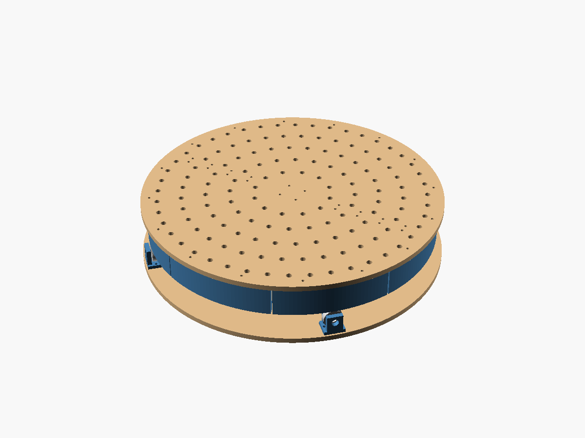
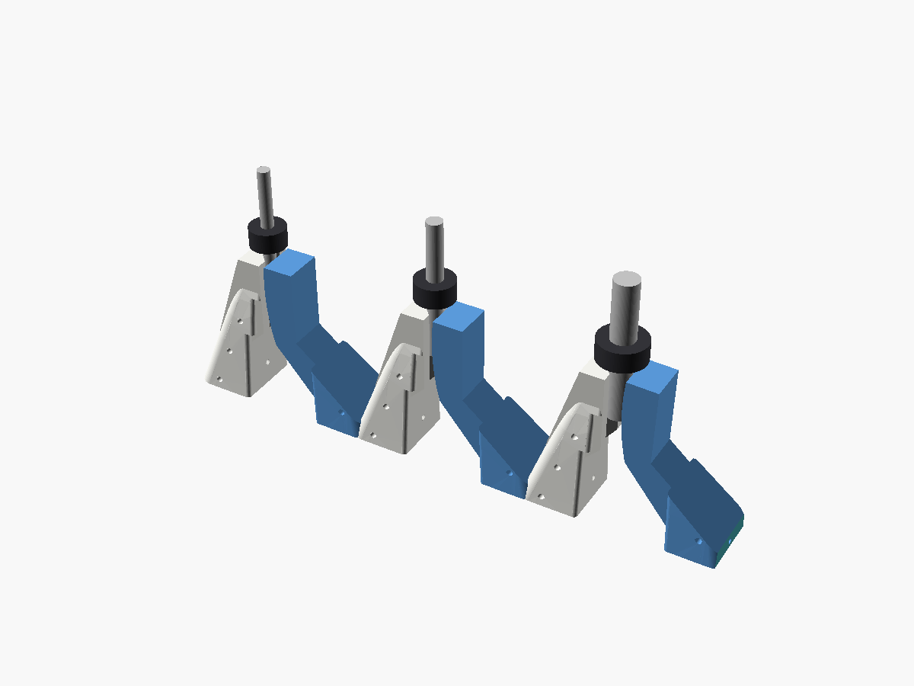

# Building the cell: carousel, pedestal and cart

Everything the SO-101 cell needs besides the Carvera, the Küpper bench and
the arm kit itself. These are the same parts the simulation uses: the sim
models and these files come from the same numbers
(`models/bit_carousel/carousel_layout.py`, `models/so101/build_so101.py`), so
a seat in the sim is a seat on the real carousel. What RViz shows of the
carousel, the pedestal and the cart *is* these parts: `gen_fab.py` also
exports them by material (`*/out/sim_*.stl`, `pedestal.stl`), and the Blender
build scripts turn those into the sim models' meshes.

| Assembly | Look | Made on | Files |
| :--- | :--- | :--- | :--- |
| **Bit carousel**: 140 seats on a turning plate; an STS3215 servo turns the wanted bit to the arm |  | plates: xTool M2 (6 mm birch ply) or the Carvera; small parts: Bambu X1 (PETG) | [`carousel/out/`](carousel/out/) |
| **Arm pedestal**: lifts the SO-101 to 5 cm above the grip height, overhangs the cart edge towards the Carvera |  | Bambu X1 (PETG) | [`pedestal/out/pedestal.stl`](pedestal/out/pedestal.stl) |
| **V-groove jaws**: the SO-101's two gripper parts with new fingertips, so a bit's shank always sits on the same line |  | Bambu X1 (PETG) | [`jaws/out/`](jaws/out/) |
| **Rolling cart**: carries both, rolls away when the Carvera's hood is shut |  | table saw / track saw (18 mm birch ply, 40 × 40 mm timber) | [`cart/out/`](cart/out/) |

Regenerate after changing a layout or size:

```bash
python3 fab/check_layout.py   # every seat leaves the open jaw >= 12 mm to its neighbours
python3 fab/gen_fab.py        # params + STL / DXF / SVG / PNG (needs OpenSCAD with Manifold)
```

`OPENSCAD=...` picks the OpenSCAD command; it needs the Manifold backend
(OpenSCAD 2024+ / nightly). The jaws are cut from TheRobotStudio's meshes:
run `models/so101/fetch_meshes.sh` once before regenerating them.

## Before you cut

- **Measure your parts, then set them** in `carousel_layout.py` /
  `fab/gen_fab.py` and regenerate. Taken from datasheets, not measured:
  the STS3215 body (24.7 × 45.2 × 35 mm), where its output shaft sits
  (`SERVO_SHAFT_FROM_END`, 11.5 mm), and the round horn (`HORN_D` 20 mm,
  `HORN_T` 3 mm, screws on a 7 mm radius).
- **Laser kerf**: `KERF = 0.2` mm in `carousel/carousel.scad` (outlines grow,
  holes shrink by half of it). Cut a test hole first: a 1/8" (3.175 mm) and a
  6 mm Makera bit should both drop through a seat hole (6.6 mm) and hang on
  their collar.
- **The seat plate is 352 mm across**, so it comes in two halves (the seam
  runs between two seats on every ring). Each half (352 × 176 mm) fits the
  xTool M2 and the Carvera (360 × 240 mm). If your laser takes 352 × 352 mm,
  cut it whole: union the two halves' outlines in your laser software.
- **On the Carvera**: the DXFs are 2D outlines; profile-cut 6 mm ply with a
  3.175 mm flat end mill, holes as pockets (they are larger than the tool).
  Hold-down tabs where the halves' straight edge meets the circle.

## Bill of materials

### SO-101 arm

Only the **follower** arm is built: `move_bit` drives it directly, so the
cell needs no leader arm.

| Qty | Part | Notes |
| ---: | :--- | :--- |
| 1 | Seeed Studio SO-ARM101 servo motor kit **Pro** (without 3D printed parts) | [openelab](https://openelab.io/a/s/products/seeed-studio-so-101-pro-servo-motor-kit-lerobot). Use the six **12 V** STS3215 (1:345), one driver board and the **12 V** supply for the follower. The six 7.4 V servos are the leader's: one of them (the 1:345) is the carousel servo below, on the 5 V supply. |
| 1 | WowRobo 2 MP USB camera for the SO-ARM101 (32 × 32 mm UVC board, 3 m cable) | [openelab](https://openelab.io/products/wowrobo-robotics-2mp-usb-camera). Wrist camera; nothing in `move_bit` uses it yet. |
| 1 | Wrist camera mount, PETG | TheRobotStudio's [hex-nut mount for 32 × 32 UVC modules](https://github.com/TheRobotStudio/SO-ARM100/tree/main/Optional/SO101_Wrist_Cam_Hex-Nut_Mount_32x32_UVC_Module) |
| 9 + 2 | Printed arm parts, PETG or PLA+ | the list below |

**Printed parts of the follower arm.** Nine come unchanged from
TheRobotStudio's [`STL/SO101/Individual`](https://github.com/TheRobotStudio/SO-ARM100/tree/main/STL/SO101/Individual)
(Apache-2.0; their [README](https://github.com/TheRobotStudio/SO-ARM100#printing-the-parts) has the print
settings and a calibration gauge), the two gripper parts come from here:

| Qty | File | Part |
| ---: | :--- | :--- |
| 1 | [`Base_SO101.stl`](https://github.com/TheRobotStudio/SO-ARM100/blob/main/STL/SO101/Individual/Base_SO101.stl) | base |
| 1 | [`Base_motor_holder_SO101.stl`](https://github.com/TheRobotStudio/SO-ARM100/blob/main/STL/SO101/Individual/Base_motor_holder_SO101.stl) | holds the pan servo in the base |
| 1 | [`Seeedstudio_Mounting_Plate_SO101.stl`](https://github.com/TheRobotStudio/SO-ARM100/blob/main/STL/SO101/Individual/Seeedstudio_Mounting_Plate_SO101.stl) | plate for the kit's driver board ([`WaveShare_Mounting_Plate_SO101.stl`](https://github.com/TheRobotStudio/SO-ARM100/blob/main/STL/SO101/Individual/WaveShare_Mounting_Plate_SO101.stl) for a Waveshare board) |
| 1 | [`Rotation_Pitch_SO101.stl`](https://github.com/TheRobotStudio/SO-ARM100/blob/main/STL/SO101/Individual/Rotation_Pitch_SO101.stl) | shoulder |
| 1 | [`Motor_holder_SO101_Base.stl`](https://github.com/TheRobotStudio/SO-ARM100/blob/main/STL/SO101/Individual/Motor_holder_SO101_Base.stl) | holds the shoulder-lift servo |
| 1 | [`Upper_arm_SO101.stl`](https://github.com/TheRobotStudio/SO-ARM100/blob/main/STL/SO101/Individual/Upper_arm_SO101.stl) | upper arm |
| 1 | [`Under_arm_SO101.stl`](https://github.com/TheRobotStudio/SO-ARM100/blob/main/STL/SO101/Individual/Under_arm_SO101.stl) | lower arm |
| 1 | [`Motor_holder_SO101_Wrist.stl`](https://github.com/TheRobotStudio/SO-ARM100/blob/main/STL/SO101/Individual/Motor_holder_SO101_Wrist.stl) | holds the wrist-flex servo |
| 1 | [`Wrist_Roll_Pitch_SO101.stl`](https://github.com/TheRobotStudio/SO-ARM100/blob/main/STL/SO101/Individual/Wrist_Roll_Pitch_SO101.stl) | wrist |
| 1 | [`jaws/out/wrist_roll_follower_vjaw.stl`](jaws/out/wrist_roll_follower_vjaw.stl) | gripper body with the fixed finger, **instead of** `Wrist_Roll_Follower_SO101.stl` |
| 1 | [`jaws/out/moving_jaw_vjaw.stl`](jaws/out/moving_jaw_vjaw.stl) | moving finger, **instead of** `Moving_Jaw_SO101.stl` |

Not needed (leader arm only): `Handle_SO101`, `Trigger_SO101`,
`Wrist_Roll_SO101`. TheRobotStudio's one-plate file
[`Prusa_Follower_SO101.stl`](https://github.com/TheRobotStudio/SO-ARM100/tree/main/STL/SO101/Follower) fits the X1's
bed but has the two stock gripper parts on it: delete those in the slicer
and add the two from `jaws/out/`.

**The jaws.** Both files sit in the same position and orientation as the
parts they replace, so they assemble the same way and print in the same
orientation (on TheRobotStudio's plate both lie with the inner finger face
up). The moving jaw's new tip stands ~18 mm above the bed in that
orientation: print it with supports. Only the last 20–35 mm of each finger
differ:

- The fixed finger has a 90° V, 3 mm deep, along the finger. A shank from
  1/8" to 6 mm pressed into it lies on the V's centre line: its axis is
  `3 − 0.707 d` mm in front of the old flat face (d = shank diameter), not
  wherever it landed on a flat finger.
- The moving finger's tip is a dog-leg: 8 mm thick like the stock tip, but
  ~8 mm closer to the fixed finger, with the stock tip behind it removed.
  Its face is crowned along the finger (60 mm radius), so it presses on one
  spot at mid grip at any closing angle. It closes on a 1/8" shank at about
  −0.093 rad, on 4 mm at −0.080 rad and on 6 mm at −0.048 rad of the jaw
  joint; with nothing between them the fingers meet at −0.104 rad, well
  inside the servo's range (the stock jaw only just reaches a 1/8" shank).
- The fingertips end 6 mm past the tool frame (stock: ~7 mm), 3 mm above
  the collar at the grasp height.
- Open for a bit (5 mm wider than its shank), the fingers reach 10–12 mm
  (fixed) and 16–18 mm (moving) from the bit's axis where the neighbouring
  bits stand; the stock jaw reached 12–13 and ~20 mm. The carousel's
  spacing (`check_layout.py`, 20 mm) therefore still holds.

Checked on the exported meshes: each of the three shank sizes touches both
V faces over the whole grip and the pad at mid grip, with nothing
overlapping, at the jaw angles `move_bit` commands. Not checked: a print,
the dog-leg's stiffness, and the grip on a real bit. If a shank
slips, a strip of thin rubber or heat-shrink on the pad adds friction
without moving the bit's position, which the V sets.

### Bit carousel

| Qty | Part | Notes |
| ---: | :--- | :--- |
| 2 | Seat plate half, 6 mm birch ply | `seat_plate_0.dxf`, `seat_plate_1.dxf` (352 × 176 mm each) |
| 2 | Base plate half, 6 mm birch ply | `base_plate_0.dxf`, `base_plate_1.dxf` (356 × 178 mm each) |
| 2 | Splice strip, 6 mm birch ply | `splice_strip.dxf`: joins the seat plate halves underneath |
| 1 | Hub, PETG | `hub.stl`: servo horn to seat plate |
| 8 | Rim segment, PETG | `rim_segment.stl`: rim under the plate's edge, rides on the rollers |
| 4 | Roller bracket, PETG | `roller_bracket.stl` (print on its side as exported) |
| 1 | Servo cradle, PETG | `servo_cradle.stl` |
| 1 | Feetech STS3215 servo, 7.4 V, 1:345, with round horn | Seeed "STS3215 19 kg·cm 7.4 V" (C001, 19.5 kg·cm stall, [link](https://www.seeedstudio.com/STS3215-19kg-cm-7-4V-Serial-Servo-p-6338.html)); if out of stock, the C046 (7.4 V, 1:147, 14.4 kg·cm, [link](https://www.seeedstudio.com/Feetech-ST-3215-C046-Standard-Torque-Servo-7-4V-1-147-Gear-Reduction-p-6461.html)). Same body and horn as the arm's servos, so the cradle and horn fit unchanged |
| 1 | Bus servo driver board | Seeed [Bus Servo Driver Board for XIAO](https://www.seeedstudio.com/Bus-Servo-Driver-Board-for-XIAO-p-6413.html) (5–12 V in): the carousel gets its own, with its own USB link, not the arm's bus |
| 1 | 5 V 2–3 A power supply (DC barrel to suit the board) | the carousel's own, as Seeed runs the 7.4 V STS3215s (leader arm); they take 5–8.4 V, **never 12 V** (the follower arm's supply) |
| 1 | 3-pin servo cable, ~40 cm, and a USB cable | servo to the driver board on the cart shelf; board to the computer |
| 4 | 608-2RS bearing (22 × 8 × 7 mm) | rollers |
| 4 | M8 × 30 bolt, nut, 2 washers | roller axles |
| 20 | M3 heat-set insert (4.0 mm OD, 5.7 mm) | hub 4, rim segments 16 |
| 20 | M3 × 10 screw | seat plate to hub and rim |
| 28 | M3 × 16 screw + nut | splice strips 16, roller brackets 8, servo cradle 4 |
| 6 | M4 × 16 countersunk wood screw | base plate to the cart top |
| ~300 g | PETG filament | |

### Arm pedestal

| Qty | Part | Notes |
| ---: | :--- | :--- |
| 1 | Pedestal, PETG (~250 g) | `pedestal.stl`, print standing as exported, 4 walls, 20 % gyroid |
| 2 | M4 × 20 countersunk wood screw | foot to the cart top (plus a bead of construction glue) |
| — | the two table clamps from the SO-101 kit | clamp the arm's base onto the pedestal's top lip |

### Rolling cart

| Qty | Part | Size (mm) | Notes |
| ---: | :--- | :--- | :--- |
| 1 | Top, 18 mm birch ply | 355 × 435 | `top.dxf`: two cable holes (arm, carousel servo) |
| 1 | Shelf, 18 mm birch ply | 315 × 395 | `shelf.dxf`: corners notched around the legs |
| 2 | Long apron, 18 mm birch ply | 325 × 60 | |
| 2 | Short apron, 18 mm birch ply | 245 × 60 | |
| 4 | Leg, planed timber | 40 × 40 × 822 | |
| 4 | Shelf cleat, timber | 20 × 20 × 100 | screwed to the legs at 150 mm (shelf top 168 mm above the floor) |
| 4 | Swivel caster with brake | 50 mm wheel, 75 mm mounting height, ≥ 25 kg | plate ~60 × 45 mm |
| 16 | 4 × 40 wood screw | | aprons to legs, top to aprons (from below, through pocket holes or angle brackets) |
| 16 | 4 × 16 wood screw | | casters |
| — | wood glue, finish (hard wax oil) | | |

The cart top ends 915 mm above the floor with these casters. That height is
what puts the carousel's seats level with the Carvera's ATC seats on the
840 mm Küpper bench (bench + 150 mm − 75 mm); with other casters, change
the leg length so the top stays at 915 mm.

## Assembly

### Cart

1. Cut the legs to 822 mm and the aprons; glue and screw the aprons between
   the legs, flush with the legs' tops and outer faces (35 mm in from the
   top's edges once the top is on).
2. Screw the cleats to the legs, shelf on the cleats.
3. Top on, flush all round, screwed from below.
4. Turn the cart over and screw on the four casters under the legs.
5. Roll it in front of the Carvera's bench and check: the top at 915 mm, its
   front edge 5 mm from the bench (`configs/carvera_so101/gen_cell_configs.py`
   has the exact position; the sim shows it).

### Pedestal and arm

1. Screw the pedestal's foot to the cart top: the block overhangs the cart's
   front edge (towards the Carvera) by 45 mm, its long side along the edge,
   the arm's pan axis 25 mm inside the Carvera's right-hand side panel line.
2. Run the arm's bus and power cables through the slot under the top lip and
   down through the cart top's small hole.
3. Clamp the SO-101's base onto the top lip with the kit's two table
   clamps, facing away from the Carvera (world −y in the sim): its pan range
   then runs from the ATC across the open machine front to the carousel and
   never towards the side panel.

### Carousel

1. **Inserts**: press the M3 heat-set inserts into the hub (4, top face)
   and the rim segments (2 each, top face).
2. **Base**: lay the two base plate halves on the cart top where the sim
   puts the carousel (its axis 203 mm / 167 mm from the arm's pan axis, see
   `CENTER_IN_PAN`), screw them down with the six M4 screws.
3. **Rollers**: a 608 between two M8 washers on an M8 × 30 bolt through each
   roller bracket, nut snug, bearing free; screw the brackets onto the base
   (M3 × 16 + nut), axles pointing at the centre.
4. **Servo**: on its own driver board, set its ID (any ID works on its own
   bus; 7 keeps it apart from the arm's 1–6 if the two ever share a bus)
   with Feetech FD software or LeRobot's motor setup, position mode, centre
   it (2048). Drop it into the cradle,
   output shaft up and on the centre mark, cable out of the slot and down
   through the base and cart top to the driver board and its 5 V supply on
   the cart shelf; screw the cradle down. Fit the round horn.
5. **Seat plate**: join the two halves upside down on a flat table with the
   splice strips along the seam (M3 × 16 + nut). Screw the hub (centre) and
   the eight rim segments (one centred on each end of the seam, then every
   45°) onto it with M3 × 10.
6. Turn the plate over onto the rollers, hub on the horn; screw the hub to
   the horn (M2 screws from the horn's kit, through the hub's access holes).
   It should turn freely with the servo unpowered.
7. **Zero**: with the servo at its centre position, turn the plate (loosen
   the horn screws) so the seam runs along world x, as in the sim; tighten.
   Seat `cell_R_C` is then at platter angle 0 where
   `carousel_layout.cells()` says, and `move_bit --turn=grid:R,C` turns it
   to its ring's pick position.
8. Put the bits in, ring 0 (inside) first, in the order of
   `configs/carvera_so101/bits.updates.pbtxt`, so the sim and the real
   carousel agree on which bit is where.

### Hood and cart

The Carvera's hood is opened and shut by hand and the cart is pushed by
hand: `move_bit --dock` (hood open, cart in) and `--park` (cart away, hood
shut) animate this in the sim and, on the real cell, ask you to do it and
wait for Enter. Park the cart before shutting the hood: the arm's pan axis
sits just inside the open hood's front.

## Not done yet

- There is no hardware driver for the SO-101 or the carousel servo yet
  (the servo kit and the camera are bought, the arm is not built);
  everything above runs in simulation. The
  carousel has its own driver board and serial port on purpose: only one
  process can open a serial port, so LeRobot driving the follower arm
  would otherwise block a separate carousel driver, and a seventh servo
  stays off the follower's 2 A supply.
- `move_bit` and the sim gripper use the V-groove jaws (jaw angles and the
  shank's place in the V from `fab/jaws/jaws.scad`), but no move has been
  run in the simulator since the change: only the geometry was checked.
- The dimensions marked as datasheet values above are not measured.
